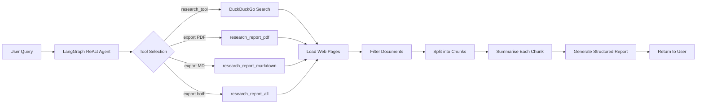

# AI Research Assistant

An intelligent, agentic research assistant that automates the process of gathering, analysing, and summarising information from the web. Instead of manually visiting multiple websites, the assistant searches relevant sources via DuckDuckGo, extracts and filters content, generates concise summaries, and produces a well-structured research report — all driven by a **LangGraph ReAct agent**.

The project is built with **LangChain / LangGraph**, **Ollama** (Llama 3.2), **FastAPI**, and a modern **React + Vite** frontend. It runs entirely on your local machine — no cloud API keys are required by default.

---

## Features

* 🤖 **Agentic workflow** — LangGraph ReAct agent autonomously selects the right tool for every request
* 🔍 **Web search** — DuckDuckGo-powered search for real-time, relevant results
* 🌐 **Multi-page extraction** — Loads and scrapes content from multiple web pages in parallel
* 🧹 **Document filtering** — Removes empty, short, duplicate, error, and boilerplate pages before processing
* ✂️ **Intelligent chunking** — Recursive text splitting for LLM-friendly document segments
* 🧠 **AI-powered summarisation** — Each chunk is individually summarised, then combined into a final report
* 📄 **Structured reports** — Professional reports with Executive Summary, Introduction, Main Concepts, Applications, and more
* 📝 **Markdown export** — Save research reports as `.md` files
* 📕 **PDF export** — Save research reports as `.pdf` files (via ReportLab)
* 📦 **Dual export** — Export both PDF and Markdown in a single command
* ⚡ **REST API** — FastAPI backend with `/chat`, `/reports`, and `/download` endpoints
* 💬 **Conversational sessions** — Multi-turn research conversations with session persistence
* 🗂️ **Session history** — Browser-side localStorage keeps full chat history across sessions
* 🖥️ **Modern UI** — React + Vite frontend with a dark-mode, glassmorphism-inspired design
* 📥 **In-chat downloads** — Download generated reports directly from chat messages
* 🔒 **Runs locally** — Powered by Ollama, no external API keys needed

---

## Tech Stack

| Layer | Technology |
|---|---|
| **LLM** | Ollama — Llama 3.2 (local) |
| **Agent** | LangGraph `create_react_agent` with MemorySaver checkpointer |
| **Chains** | LangChain `ChatPromptTemplate` → LLM → `StrOutputParser` |
| **Web Search** | `DuckDuckGoSearchResults` (langchain-community) |
| **Web Scraping** | BeautifulSoup / LangChain `WebBaseLoader` |
| **Backend** | FastAPI with CORS, Pydantic request/response models |
| **Frontend** | React 19, Vite 8, React Markdown, Lucide Icons |
| **PDF Generation** | ReportLab |
| **Styling** | Vanilla CSS (Inter + Outfit + JetBrains Mono from Google Fonts) |

---

## Project Architecture

```
AI Research Assistant/
├── agent.py                  # LangGraph ReAct agent definition & tool registry
├── config.py                 # LLM configuration (Ollama / Llama 3.2)
│
├── API/
│   ├── main.py               # FastAPI app, CORS, router registration
│   ├── models/
│   │   ├── request.py         # ChatRequest Pydantic model
│   │   └── response_model.py  # ChatResponse Pydantic model
│   └── routes/
│       ├── chat.py            # POST /chat — invoke agent, return response + download links
│       ├── reports.py         # GET  /reports — list generated report files
│       └── download.py        # GET  /download/{filename} — serve PDF/MD files
│
├── tools/
│   ├── search_tool.py              # DuckDuckGo search wrapper
│   ├── loader_tool.py              # WebBaseLoader for page extraction
│   ├── research_tool.py            # Default tool — research + return text
│   ├── research_pdf_tool.py        # Research + save as PDF
│   ├── research_markdown_tool.py   # Research + save as Markdown
│   └── research_report_all.py      # Research + save as PDF & Markdown
│
├── chains/
│   ├── summarize_chain.py    # Prompt → LLM → StrOutputParser (chunk summaries)
│   └── report_chain.py       # Prompt → LLM → StrOutputParser (final report)
│
├── prompts/
│   ├── summarize_prompt.py   # Chunk summarisation prompt template
│   └── report_prompt.py      # Structured report generation prompt template
│
├── services/
│   ├── research_service.py   # End-to-end pipeline: search → load → filter → chunk → summarise → report
│   ├── save_pdf.py           # Save report as PDF via ReportLab
│   └── save_markdown.py      # Save report as Markdown file
│
├── utils/
│   ├── documentFilter.py     # Multi-stage document quality filter
│   ├── text_splitter.py      # Recursive character text splitter
│   └── url_validator.py      # URL validation utilities
│
├── frontend/                 # React + Vite SPA
│   ├── index.html
│   ├── vite.config.js        # Dev server proxy to FastAPI on :8000
│   └── src/
│       ├── App.jsx            # Main app — chat UI, starter prompts, session switching
│       ├── api.js             # API client (chat, reports, download, health-check)
│       ├── sessionStore.js    # localStorage session persistence layer
│       ├── index.css          # Global styles (dark theme, glassmorphism)
│       └── components/
│           ├── Sidebar.jsx           # Session list, search, connection status
│           ├── ChatMessage.jsx       # Message bubble with Markdown rendering & downloads
│           └── ReportViewerModal.jsx # In-app Markdown/PDF report viewer
│
├── reports/                  # Generated PDF & Markdown reports (git-ignored)
├── requirements.txt          # Python dependencies
└── .env                      # Environment variables (API keys)
```

---

## How It Works



1. **User enters a research topic** via the chat interface or API.
2. **The ReAct agent** analyses the request and selects the appropriate tool.
3. **DuckDuckGo** searches for relevant sources (top 2 results).
4. **Web pages are loaded** and scraped using `WebBaseLoader`.
5. **Documents are filtered** — empty, short, duplicate, error, and boilerplate pages are discarded.
6. **Remaining content is chunked** using `RecursiveCharacterTextSplitter`.
7. **Each chunk is summarised** by the LLM via the summarise chain.
8. **Summaries are combined** into a comprehensive, structured research report via the report chain.
9. **The report is returned** in-chat, and optionally saved as PDF and/or Markdown.

---

## Getting Started

### Prerequisites

* **Python 3.10+**
* **Node.js 18+** and npm
* **Ollama** installed and running ([ollama.com](https://ollama.com))

### 1. Clone the Repository

```bash
git clone https://github.com/Rohitbhatia2802/AI-Research-Assistant.git
cd AI-Research-Assistant
```

### 2. Set Up Python Environment

```bash
python -m venv venv

# Windows
venv\Scripts\activate

# macOS / Linux
source venv/bin/activate

pip install -r requirements.txt
```

### 3. Pull the LLM Model

```bash
ollama pull llama3.2
```

### 4. Start the FastAPI Backend

```bash
uvicorn API.main:app --reload --port 8000
```

The API will be available at `http://127.0.0.1:8000`. Visit `http://127.0.0.1:8000/docs` for the interactive Swagger UI.

### 5. Start the React Frontend

```bash
cd frontend
npm install
npm run dev
```

The frontend will be available at `http://localhost:5173`.

---

## API Endpoints

| Method | Endpoint | Description |
|---|---|---|
| `GET` | `/` | Health check / welcome message |
| `POST` | `/chat/` | Send a research query (with optional `session_id` for follow-ups) |
| `GET` | `/reports/` | List all generated report files with metadata & download links |
| `GET` | `/download/{filename}` | Download a specific PDF or Markdown report |

### Example — Chat Request

```bash
curl -X POST http://127.0.0.1:8000/chat/ \
  -H "Content-Type: application/json" \
  -d '{"message": "Research Vector Databases"}'
```

### Example — Export as PDF

```bash
curl -X POST http://127.0.0.1:8000/chat/ \
  -H "Content-Type: application/json" \
  -d '{"message": "Research Vector Databases and save as PDF", "session_id": "abc123"}'
```

---

## Environment Variables

Create a `.env` file in the project root (optional — only needed if you switch away from Ollama):

| Variable | Description |
|---|---|
| `GROQ_API_KEY` | API key for Groq (if using Groq-hosted models) |
| `OPENROUTER_API_KEY` | API key for OpenRouter (if using OpenRouter-hosted models) |

> **Note:** The default configuration uses Ollama with Llama 3.2 locally. No API keys are required unless you modify `config.py` to use a cloud provider.

---

## Use Cases

* 📚 Academic research and literature reviews
* 📖 Technical documentation and concept exploration
* 📊 Market research and competitive analysis
* 🎓 Learning new technologies and frameworks
* 🏢 Company and product research
* ⚡ Quick topic exploration and fact-finding

---

## License

This project is open source and available under the [MIT License](LICENSE).
